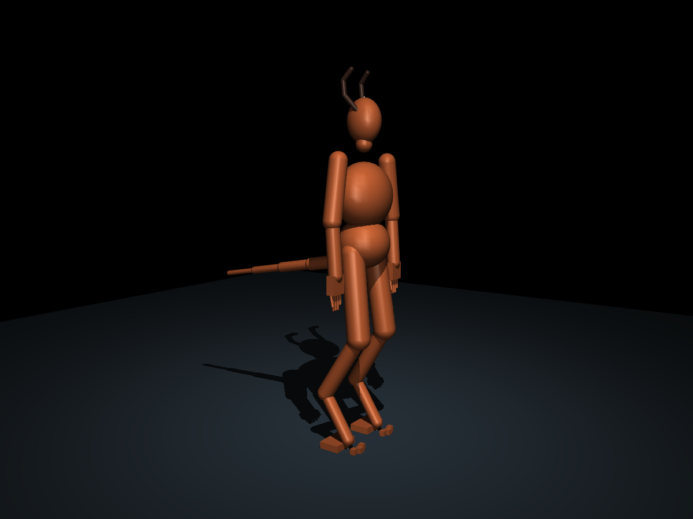

# بدن مفصل‌دار و اتصال اجرایی WBC — ۲۰ اکتبر ۲۰۲۶

بدن آزمایشی ۱۶۵ کیلوگرمی را از یک جرم نقطه‌ای به مدل چندجسمی MuJoCo تبدیل کردم و آن را با کد واقعی WBC‑Mjlab وارد، بررسی و ثبت کردم. این نسخه **۳۷ جسم صلب، ۵۵ مفصل محرک‌دار و پایهٔ آزاد با ۶ درجهٔ آزادی** دارد. هنوز سیاستِ آموخته‌شدهٔ راه‌رفتن یا دویدن ندارد.



این تصویر رندر مستقیم مدل فیزیکی است؛ شکل‌های هندسی ساده برای جرم، اینرسی و برخورد استفاده شده‌اند و جایگزین ظاهر هنریِ تأییدشده نیستند.

## ساخته و اجرا شده

- قد تا تاج سر ۲٫۵ متر؛ جرم کل کامپایل‌شده ۱۶۵٫۰۰۰ کیلوگرم.
- هر دست پنج انگشت و هر پا سه انگشت دارد. اندام‌های پنجه‌رو از طول‌های سه‌گانه و هندسهٔ مرجعِ کد بومی ساخته شده‌اند.
- تنه، گردن، شانه، آرنج، مچ، انگشت‌ها، لگن، زانو، مفصل خرگوشی، جلوی پا و انگشت‌های پا مفصل دارند.
- دم چهار بخش متصل، هرکدام با دو محور چرخش دارد؛ طول مجموع ۱٫۲ متر و جرم کل حدود ۸٫۴۶ کیلوگرم است.
- سهم جرم سر، تنه، دست‌ها، پاها و دم متناسب با تقسیم‌بندی بومیِ ۱۹۵ کیلوگرمی کاهش یافته است. تقسیم بیشتر جرم درون هر اندام، ابعاد شکل‌های اینرسی، حدود مفصل و گشتاور و ضرایب کنترل، فرض‌های طراحی تازه‌اند؛ اندازه‌گیری زیستی نیستند.
- مساحت هندسیِ پدهای تماس هر پا ۰٫۰۳۹۲۶۶۵ متر مربع است؛ همان مقدارِ فایل تماس بومی. تماس اولیه فقط روی پدهای پا است؛ در وضعیت اولیه خودبرخوردی ثبت نشد.
- مرکز جرمِ محاسبه‌شده در وضعیت مرجع **۱٫۴۱۱۵ متر** است، حدود ۹٫۷۵ سانتی‌متر بالاتر از فرض ۱٫۳۱۴ متری موتور ساده. عدد قدیمی به مدل تحمیل نشده است؛ ادعای انتقال خودکار نتایج دویدن قبلی به این اسکلت نداریم.

جرم دقیق، تعداد انگشت‌ها، سطح تماس، اینرسی مثبت و شناسایی همهٔ مفاصل با آزمون خودکار بررسی شده‌اند.

## اتصال واقعی به WBC‑Mjlab

نسخهٔ کد upstream در commit `eb6c024b9586bc1de41b3dd22b9f18ad51cb1da9` نصب شد. توابع واقعی `inspect_model`، `prepare`، `settle_test`، `save_spec` و ساخت تنظیمات محیط اجرا شدند. هیچ جایگزین ساختگی برای این توابع استفاده نشده است.

WBC تمام ۵۵ مفصل را شناخت، ۵۵ گروه محرک ساخت و سه وظیفه را ثبت کرد:

- `Wbc-Nasuraya`
- `Wbc-Nasuraya-SE`
- `Wbc-Nasuraya-Terrain-Scan`

ثبت در پوشهٔ جداگانه حفظ شد و سپس ابزار مستقلِ `wbc-mjlab-list-envs` در پردازشی تازه، بدن و هر سه وظیفه را دوباره فهرست کرد. مشخصات WBC به‌صورت صریح به **تمام پا و سه انگشت** متصل شده‌اند؛ پیشنهاد خودکار upstream که فقط اولین انگشت را به‌عنوان پا انتخاب می‌کرد پذیرفته نشد. سر، تنه و دو انتهای زنجیرهٔ دم نیز در مجموعهٔ اجسام دنبال‌شده قرار دارند.

در آماده‌سازی استاندارد upstream، محرک‌های فایل اولیه حذف می‌شوند و WBC محرک‌های PD خود را از مشخصات می‌سازد. این رفتار ثبت و بررسی شده است. ساخت تنظیمات محیط و کامپایل مدل آماده موفق بود؛ اجرای محیط آموزشی، تبدیل مجموعهٔ حرکت و آموزش سیاست انجام نشده است. CUDA در محیط این اجرا در دسترس نبود.

## نتیجهٔ آزمون‌های فیزیکی

| آزمایش | نتیجهٔ مشاهده‌شده | برداشت مجاز |
|---|---|---|
| بررسی رسمی WBC، نیم‌ثانیه | تمام بررسی‌ها موفق؛ تماس فقط روی پا، افت ارتفاع لگن از ۱٫۴۲۵ به ۱٫۳۷۹ متر، انحراف حدود ۰٫۱۸ درجه | فایل و کنترل اولیه برای شروع کار سازگارند؛ اثبات تعادل طولانی نیست |
| نگه‌داشتن مفاصل، پنج ثانیه | شبیه‌سازی عددی سالم ماند ولی بدن افتاد؛ ارتفاع لگن به حدود ۰٫۱۸۸ متر رسید و تنه با زمین تماس یافت | کنترل وضعیت ثابت برای تعادل کافی نیست؛ این مورد شکست تعادل است |
| فرود از ارتفاع ۵ سانتی‌متر، نیم‌ثانیه | تماس فقط روی پا؛ اوج نیروی نرمال مجموع حدود ۵۱۴۳ نیوتن؛ ارتفاع نهایی لگن ۱٫۳۸۳ متر | یک آزمون محدود فرود؛ نه حد ایمن بافت و نه دویدن |
| دم بی‌حرکت، بدون گرانش و تماس | چرخش پایه صفر ماند | کنترل مقایسه‌ای |
| حرکت دم، بدون گرانش و تماس، ۰٫۸ ثانیه | دم در مفصل پایه حدود +۲۳٫۸ درجه و تنه حدود −۷٫۲۶ درجه چرخید | حرکت دم از طریق دینامیک داخلی می‌تواند جهت تنه را تغییر دهد؛ نجات از سقوط اثبات نشده |
| همان آزمون با نصف گام زمانی | چرخش تنه −۷٫۲۶۳ درجه در برابر −۷٫۲۶۳ درجه با گردکردن | پاسخ مشاهده‌شده به این کاهش گام زمانی حساسیت کمی داشت |

هفت اجرای فیزیکی شامل کنترل بدون محرک نیز در فایل نتایج نگهداری شده‌اند؛ تمام شکست‌ها ثبت‌اند. در آزمون دم، نیروی تماس زمین صفر بود و بیشینهٔ اندازهٔ تکانهٔ زاویه‌ای فیزیکی زیر‌درخت حدود ۰٫۰۰۰۷۵ کیلوگرم‌مترمربع بر ثانیه بود که با نصف‌شدن گام زمانی تقریباً نصف شد. نتیجه به تقریب جسم صلب، اینرسی هندسی و پارامترهای همین مدل محدود است.

هیچ نیروی کمکی به پایه اعمال نشده است. کنترلِ اجراهای محلی فقط از موتورهای مفصلی محدودشده استفاده می‌کند. کنترل‌های آموزش WBC در این ارزیابی اجرا نشده‌اند.

## بازتولید

از ریشهٔ مخزن، در محیط جداگانه:

```bash
python -m venv .venv-articulated
.venv-articulated/bin/python -m pip install \
  -r examples/nasuraya_research/articulated/requirements.txt \
  --extra-index-url https://download.pytorch.org/whl/cpu \
  --extra-index-url https://pypi.nvidia.com

.venv-articulated/bin/python -m examples.nasuraya_research.articulated.build
.venv-articulated/bin/python -m unittest examples.nasuraya_research.articulated.test_model -v
.venv-articulated/bin/python -m examples.nasuraya_research.articulated.evaluate

export WBC_MJLAB_CONFIG_DIR=/tmp/nasuraya-wbc
.venv-articulated/bin/python -m examples.nasuraya_research.articulated.install_wbc \
  --config-dir "$WBC_MJLAB_CONFIG_DIR"
.venv-articulated/bin/wbc-mjlab-list-envs
```

چهار آزمون خودکار موفق‌اند. نسخه‌های بررسی‌شده: MuJoCo 3.11.0، mjlab 1.6.0، NumPy 2.4.6 و Torch 2.14.1+cpu؛ کد WBC به commit مشخص قفل شده است. نصب اولیهٔ MuJoCo 3.16 با مقایسهٔ نوع مفصل در upstream ناسازگار بود؛ محیط جداگانه با نسخهٔ سازگار بازسازی شد. نتیجهٔ نصب ناسازگار به‌عنوان موفقیت گزارش نشده و هیچ معیار upstream غیرفعال نشده است.

## فایل‌ها و کار باقی‌مانده

- [مدل MJCF](../assets/nasuraya_articulated_v01/nasuraya.xml)
- [مشخصات اتصال WBC](../assets/nasuraya_articulated_v01/robot.yaml)
- [فرض‌ها و منشأ ابعاد](../assets/nasuraya_articulated_v01/provenance.json)
- [نتایج کامل](../evidence/articulated-body-v01/results.json)
- [آزمون‌های خودکار](../evidence/articulated-body-v01/tests.txt)
- [ثبت وظیفه‌ها در پردازش مستقل](../evidence/articulated-body-v01/registered-tasks.txt)
- [فهرست وابستگی‌های اجرا](../evidence/articulated-body-v01/environment-freeze.txt)

مرحلهٔ انجام‌شده، ساخت اسکلت و اتصال اجرایی به چارچوب کنترل است. مرحلهٔ بعد، کنترل بازخوردیِ تعادلِ همین بدن مفصل‌دار و سپس تهیهٔ حرکت مرجع مناسب و آموزش حرکت است. نسخهٔ فعلی عضله، تاندون، بافت نرم، بازخورد حسی زیستی، شروع دویدن یا توقف آموخته‌شده ندارد و در موتور فیزیولوژیِ بومی جایگزین نشده است.
