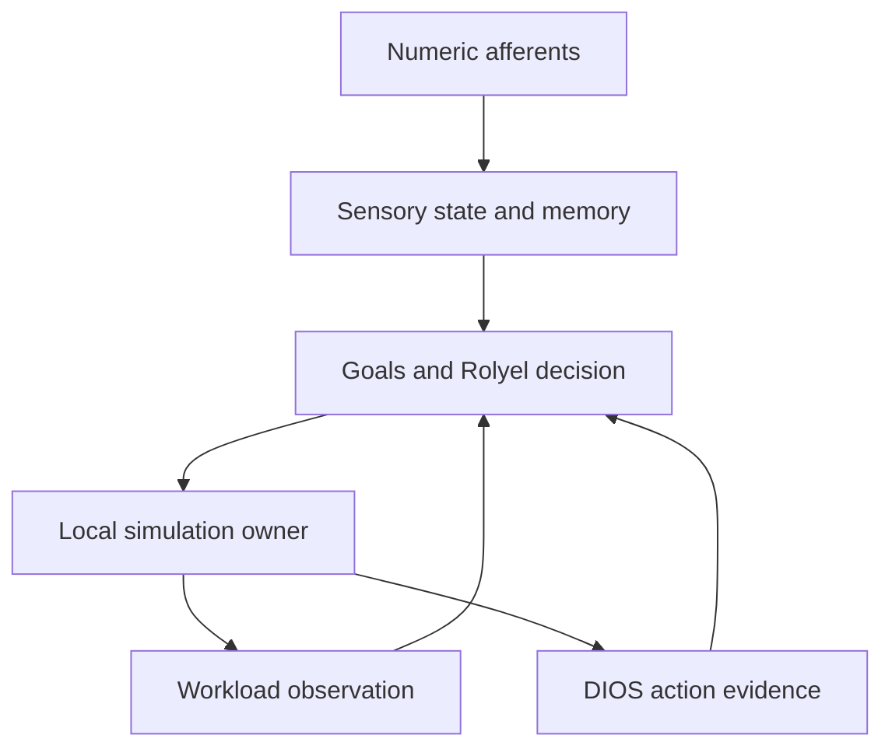

# Nasuraya shared local session v0.1

This composes the existing PR194/195 implementations into **one bounded session**.
It is an offline simulator with numerical state and actual calls to the existing
DIOS, goal, memory, Rolyel, ToolHost and optional native body code. No language
model, image provider, server, physical actuator or remote message is connected.

## Four integration stages

1. Inventory and pin existing components; distinguish execution from references.
2. Use one ordered session for afferents, internal state, workload, goals,
   decision, execution and feedback.
3. Retain checkpoints, action budget, stop, event identities and cognitive
   projections across fresh processes and interrupted writes.
4. Exercise portable and native sessions, failure recovery and inherited tests.

The starting stack is PR195 `61050eb1a3079e9a0b422380d99a31cafc34915a` on PR194.
This does not merge all open research branches or deploy any running service.

## Run

Python 3.11+ and the standard library suffice. The workshop runs on Windows and
Linux; the inherited native runtime requires Linux. From the repository root:

```bash
python -m unittest examples.nasuraya_runtime.test_session -v
python -m examples.nasuraya_runtime demo --output /tmp/nasuraya-shared-demo
python -m examples.nasuraya_runtime demo --native --output /tmp/nasuraya-native-demo
```

Use a new output directory for each demo. The native demo runs three cases:
workshop, normal native body, and native body with the existing sleep fixture.
Each runs four sensory windows, closes/reopens, checks replay and persists stop.
It writes full snapshots, receipts, SQLite state, per-revision cognitive stores
and the independently executed genome/neural/affect fixture artifacts.

For a session controlled one operation at a time:

```bash
python -m examples.nasuraya_runtime create --session /tmp/nasuraya-session --backend workshop --max-actions 8
python -m examples.nasuraya_runtime step --session /tmp/nasuraya-session --frames /tmp/afferents.json --event-id palm-1 --revision 0
python -m examples.nasuraya_runtime snapshot --session /tmp/nasuraya-session --output /tmp/nasuraya-snapshot.json
python -m examples.nasuraya_runtime stop --session /tmp/nasuraya-session
```

`afferents.json` is a JSON array of 1–16 objects, each with exactly `timestamp`
and six numeric `values`. Example of a one-tick quiet observation:

```json
[{"timestamp":0.1,"values":[0,0,0,0,0,0]}]
```

Each timestamp must advance the session clock by 0.1 s. The API accepts no
stimulus type, label, truth, prompt or visible hint. `Session.step()` requires an
exact tuple of the existing `AfferentFrame` objects and an expected revision.
The demonstration fixture produces labelled stimuli outside this boundary.
This API separation is not a security boundary against hostile code in the same
Python process.

The default evidence-evaluation time is a fixed reproducibility timestamp,
`2026-11-12T12:00:00+00:00`; it is not the current time or a live server check.
Set `create --at-utc` explicitly for another evaluation time. Frozen receipts
are never upgraded to current authenticated observations.

## Actual event path



Every completed transition has one central SQLite checkpoint and event receipt.
The native backend calls the existing `UnifiedBody.cycle()` in a fresh process
on 70 source-verified copied runtime files. It retains the actual native
checkpoint, neural clock, affect/somatic feedback, energy/water audit and touch
provenance. Native body time starts after the fixture's 7 s warm-up. The separate
sensory clock starts at zero; equal elapsed durations advance both clocks.

The prior native outcome is projected through PR194's validated body export and
`RecoveryAdvisor` on the next event. Only ACTIVE advice permits requesting work.
Native energy and sympathetic index also feed Rolyel's existing energy/heat-scale
contract; that conversion is explicitly an authored feasibility proxy. The body
retains its own protective veto. The workshop instead observes its actual energy
and heat through `ToolHost`; it does not masquerade as native physiology.

The PR195 frozen full decoder consumes internal-state features only. Its trained
parameters, temperature and source file are pinned; no test-time model update
occurs here. Native touch is a scalar projection of these features. Location and
type remain available to introspection, but the native API has no regional palm
withdrawal actuator. The demonstrated native requests are walk/observe.

The original `CognitiveSession` records detector outputs as **unverified**. It
records an actual local action receipt as observed *simulation* evidence. The
claim is narrowly "this requested action matched the executed action". Claims
are separate for recover, process_job, walk and observe. A successful observation
cannot erase a walk veto. DIOS reviews the proposed action's retained evidence
before another action; dissent defers work to recover/observe. This conservative
deferral has no automatic expiry in this bounded session. Learning when a veto
has ceased to apply needs a separately validated context/retry policy.

The existing `AdvisoryGoalPlanner` preserves one authored goal across these
events. Its stop follows the authoritative central stop and survives reopening.
No body pressure or successful action grants external-action permission.

## Crash and replay semantics

- A unique event ID commits at most one local simulated transition. An exact
  duplicate returns its original JSON receipt; different data under the same ID
  is rejected. Revision comparison rejects stale concurrent writers.
- `BEGIN IMMEDIATE` serializes writers. Computation happens before the atomic
  event/checkpoint commit. The optional native worker has no durable side effects
  outside its disposable copy, so an uncommitted simulation can be recomputed.
- Existing DIOS and goal persistence are **derived projections**. For every
  committed revision, the complete bounded event history is replayed through
  their original APIs in a new temporary directory. A completed directory is
  published by rename. It is never edited for a later revision.
- Failure after central commit but before projection publication is reconciled
  on reopen or exact replay. Process death inside a legacy multi-file write
  leaves an unused `pending-*` directory for diagnosis. A damaged published
  projection fails closed. No next action runs with an unresolved projection.
- A budget is retained centrally, including across replay and reopen. Stop is
  permitted after exhaustion and before any observation. There is no reset or
  resume-after-stop command.

Tests cover process termination during projection writes, not hardware power
loss, network partitions, hostile local writers or arbitrary filesystem failure.
Digests are consistency checks, not authenticated signatures. Copies of this
simulated session are independent branches, not one globally unique agent.
No exactly-once physical or remote execution claim is made.

## Other components and honest boundaries

| Component | Integration in this session |
|---|---|
| DIOS/Goal Continuity/Epistemic Revision/Evidence Memory | Original APIs run for every committed event; action-specific review affects selection |
| Interoception/attention/short-term memory | Same continuous state survives all windows and restarts |
| Native body/neural/affect | Actual native cycles when Linux backend selected; somatic feedback changes; this fixture did not change affect intensity values |
| Genome | Original pinned fixed fixture executes at initialization; its phenotype proposal is not applied to native physics |
| Visual Director | Exact PR175 planner and dependencies reused with source pins; numeric load selects an authored resting/exercise context; three text plans, no render |
| Ritual | PR194's pinned progress reference, not an executed ritual or proof of mastery |
| Server/Moltbook/desktop | Frozen references only; no live connection or authenticated ingress |
| 78 kg target body | Atlas reference; native reduced solver remains 195 kg |
| LLM/chat/image generation | No API calls or access to model weights/hidden state |

Legacy affect checkpoint JSON bytes can differ because of dictionary insertion
order even when semantic state is identical. Original byte hashes are retained
in `fixed-models-report.json`; common snapshots compare canonical semantic state.

Each action creates a fresh immutable projection by bounded replay. This favors
inspectability over speed: total projection work grows quadratically with the
number of events (at most 100 actions plus stop). Native checkpoints also include
their retained history. This is suitable for short research sessions, not an
unbounded service. No learning benefit, task-utility improvement, continuous-
window calibration or subjective experience is established by these tests.

See [verified results](../../docs/research/NASURAYA_INTEGRATION_RESULTS_2026-11-12_FA.md)
and [retained evidence](../../docs/evidence/nasuraya-integration-v01/README.md).
