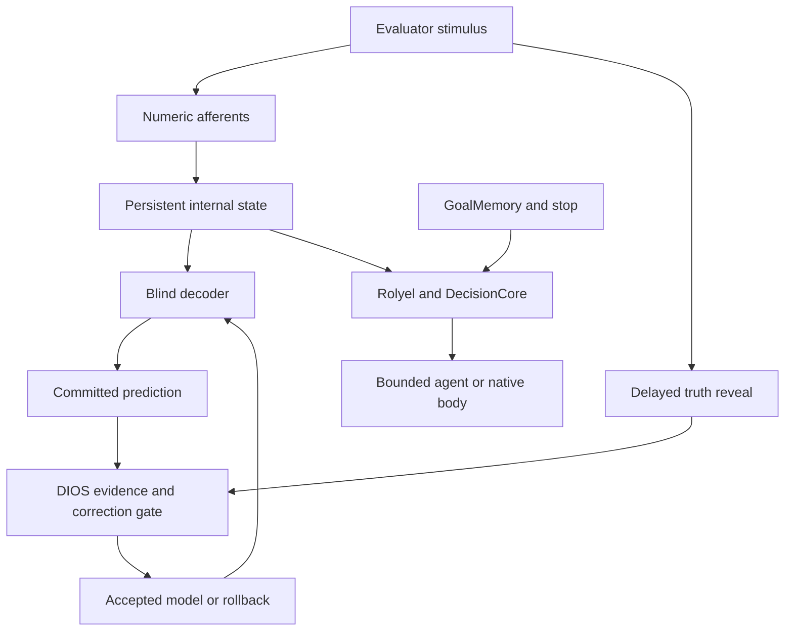

# Tadash artificial interoception v0.1

Executable **functional internal-state monitoring** of synthetic palm signals.
Touch is an external sense; the internal consequences are the research target.
This is a supervised software experiment, not evidence of subjective experience.

Python 3.11+, standard library only. Numeric tests and the local workshop run on
Linux/Windows. The source-pinned native body requires Linux (`fcntl`).

From the repository root:

```sh
python -m unittest examples.tadash_interoception.test_interoception -v
python -m unittest discover -s examples/dios_nous -v
python -m unittest discover -s examples/nasuraya_agent_loop/tests -v
python -m examples.tadash_interoception.demo --output /tmp/palm-agent-demo
python -m examples.tadash_interoception.demo --native --output /tmp/palm-native-demo
python -m examples.tadash_interoception.evaluate --include-test --output /tmp/palm-regression
python -m examples.nasuraya_body_loop test
```

Use new output paths. Existing directories/files are not overwritten. On Windows
use ordinary writable paths and omit `--native`. No API keys, model downloads or
network access are needed. The last evaluation is a **regression** of the frozen
confirmation experiment, not a new independent test. The default evaluator without
`--include-test` runs only training, diagnosis and acceptance validation.

## Actual interfaces

| Layer | API | Data/behavior |
|---|---|---|
| Evaluator-only stimulus | `Stimulus`, `transduce()` | Location, intensity, duration, frequency, type, noise, onset timestamp |
| Blind input | `AfferentFrame(timestamp, values)` | Exactly six numeric channels; no seed, label or truth |
| Persistent internal state | `InternalState.step/checkpoint/restore` | Filtered sensation, two attention weights, 12-frame memory, load, prediction residual |
| Learned readout | `Decoder.predict(tuple_of_12_features)` | Occurrence probability, location/type, intensity, conditional vote confidence |
| Observer | `DiosObserver` | Flush prediction first, reveal truth second, DIOS disagreement review, hash-chain trace |
| Correction | `develop`, `correction_gate` | Non-novel diagnosis fitting, separate non-novel validation, accept or retain old model |
| Memory/revision | Existing `CognitiveSession`, `critical_review` | Real SQLite evidence storage, cold reopening, recorded belief revision |
| Goal continuity | Existing `AdvisoryGoalPlanner` | Existing GoalMemory checkpoint and sticky stop |
| Decisions | Pinned PR185 `rotate`, existing `DecisionCore` | Numeric internal pressure changes route while preserving goal |
| Agent | Existing `ToolHost`, `run_local`, new `SensoryPolicy.introspect` | Actual local recover/process action and numeric uncertainty report |
| Native body | Existing `BodyLoop`, `ReflectiveBody`, `UnifiedBody.cycle` | Touch sample ingestion, bounded walk/observe preference, returned protected action |



Truth exists in the trusted evaluation process, never in the decoder argument.
This is a logical API separation, not a security sandbox against malicious code
in the same process. All rows from an episode stay in one split. Samples within
an episode are correlated; sample size is episodes, not ticks.

## Numeric model and meaning

Six afferents represent two palms and three mixed channels. Mechanical tonic
drive, delayed thermal rise and a vibration envelope are authored equations.
State uses rectification, an exponential filter (time constant .18 simulation
seconds), spatial gain, a 12-frame bounded trace, mean/max features and a slower
load state. Time steps are .1 simulation seconds. These equations are not a
biologically calibrated tactile or visceral model. The frequency envelope is
coarsely sampled and can alias; do not interpret it as validated human Hz coding.

Nine-neighbour inverse-distance voting is trained on numeric state features.
The temperature parameter calibrates **binary occurrence only**; modality vote
confidence and the uncertainty flag are not calibrated novelty probabilities.
The closed class set cannot name an unseen compound stimulus. Prediction error
is a one-step sensory-filter residual, not an LLM prediction error.

`action_pressure = min(1, load + .2*max(features) + .1*prediction_error)` is an
authored control proxy. Memory and attention can therefore affect behavior.
It cannot change evidence truth, grant authority or override stop/budgets.
Decoder self-correction changes readout; it does not alter this action policy.

## Correction, failure retention and rollback

Read the original protocol and corrective addendum in `docs/research/`. The first
500-case run inadvertently used novel-family binary outcomes for temperature
selection and validation acceptance. All original artifacts are retained under
`docs/evidence/tadash-interoception-v01/first-*`. The corrected implementation
excludes the novel family from **all fitting and acceptance** and uses fresh
confirmation seeds 750000–750499. Known diagnosis/calibration seed IDs are recorded.

Run 1 diagnoses a trained baseline. Run 2 fits a candidate and accepts it only if
binary Brier improves and accuracy drops by at most .02 on separate validation.
Run 3 compares frozen selected and baseline models. DIOS reviews every revealed
outcome in all phases and persists the correction decision. The correction rule
is bounded and authored; DIOS does not invent code or discover causal mechanisms.
Secondary metric regressions are reported; the gate does not optimize all metrics.

`frozen_models.json`, `rollback_models.json`, `report.json` and `observer.jsonl`
are written by each run. To load an old model explicitly:

```python
import json
from examples.tadash_interoception.model import Decoder
saved = json.load(open('/tmp/palm-regression/rollback_models.json'))['full']
old = Decoder([(tuple(f), label, intensity) for f, label, intensity in saved['examples']],
              temperature=saved['temperature'])
assert old.fingerprint() == saved['sha256']
```

Checksums detect accidental inconsistency when their anchors are trusted. They
are not signed provenance. SQLite/goal persistence reuses the existing contracts.
The sensory checkpoint is explicit JSON, with a cold-process test. This release
does not provide a continuously running service or automatic remote restart.

## Native execution limits

The demonstration verifies/copies 70 original native sources to disposable
staging, then executes one action in each of three fresh local body sessions.
It checks retained touch, budget exhaustion, native sleep protection, unchanged
original source files, and checkpoint identity after cold reopening. Native
physiology remains the existing 195 kg model; the 78 kg visual/mechanical targets
are not silently substituted. Palm position/modalities remain in the new sensory
layer; the existing native sense bus receives scalar touch. There is no native
hand withdrawal actuator or new anatomical hand mesh.

No VPS, Moltbook, production database or language-model API is connected. Existing
server evidence integrations are audited and their core memory/decision code is
reused; no unrelated remote receipt task is run. No new third-party dependencies.
